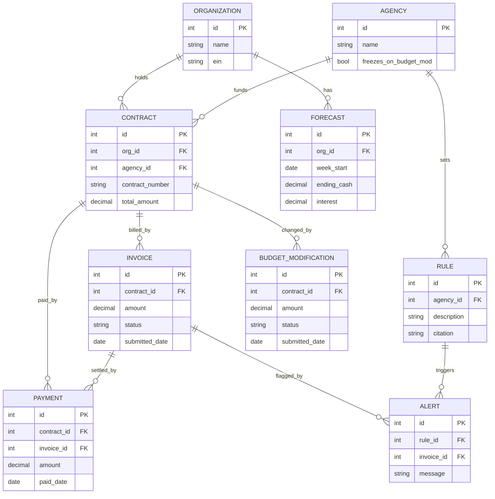
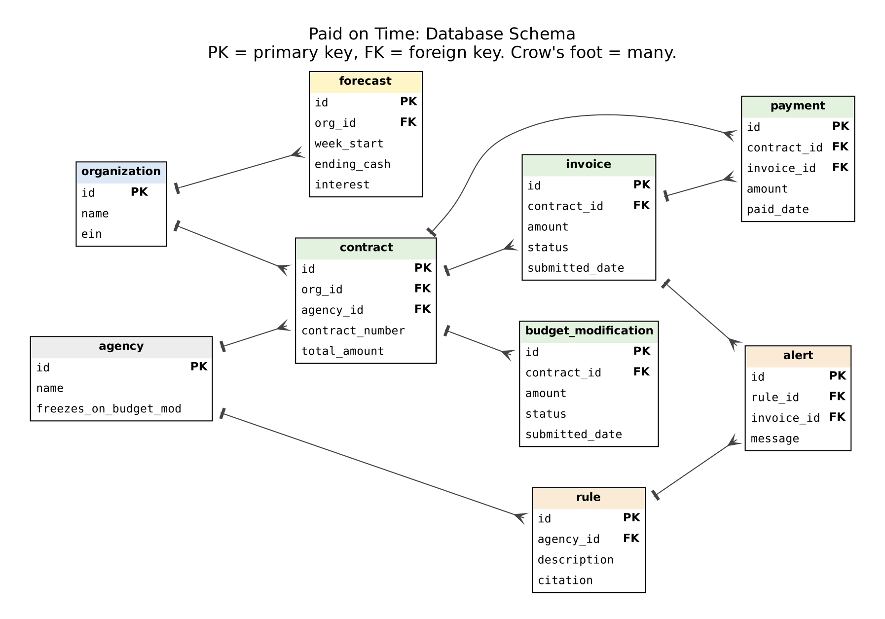

# Data model

The schema lives in `backend/app/models.py`. Keep this page and that file in sync.

Original diagram:

## Notes

- Money is stored as `NUMERIC(14, 2)`, never floats, so cents don't drift.
- `payment.invoice_id` is optional so a payment can be stored before it's matched to an
  invoice.
- `agency.freezes_on_budget_mod` drives the freeze warning in `app/rules.py`.
