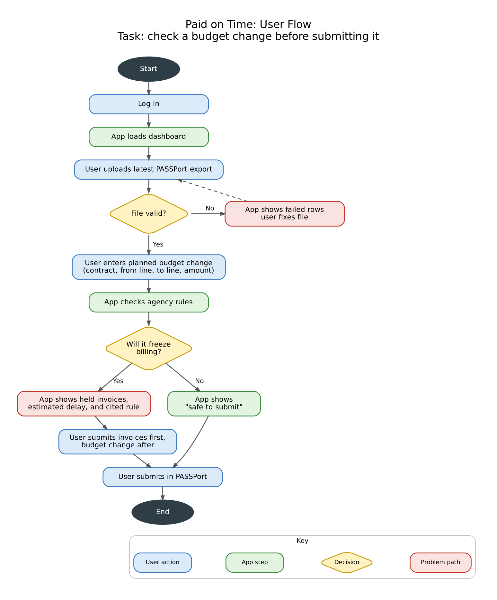
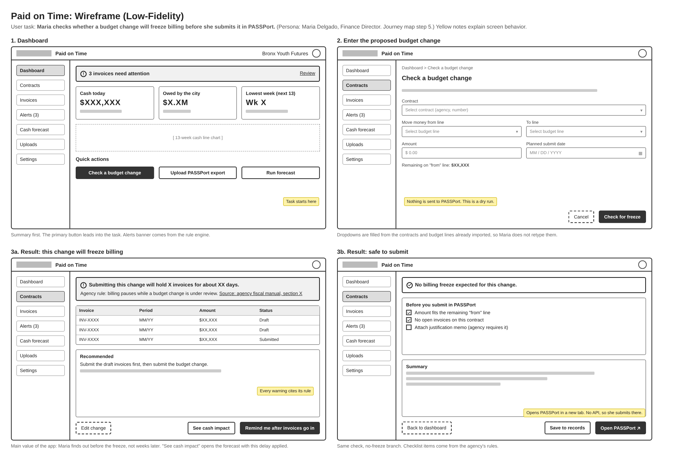
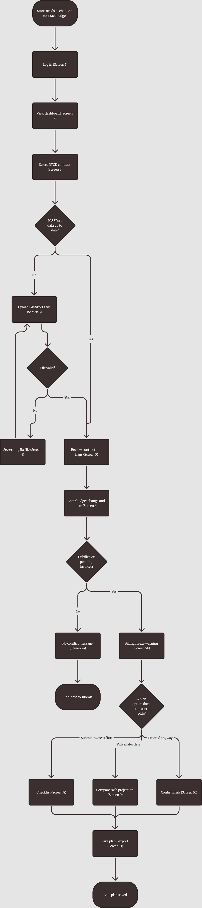
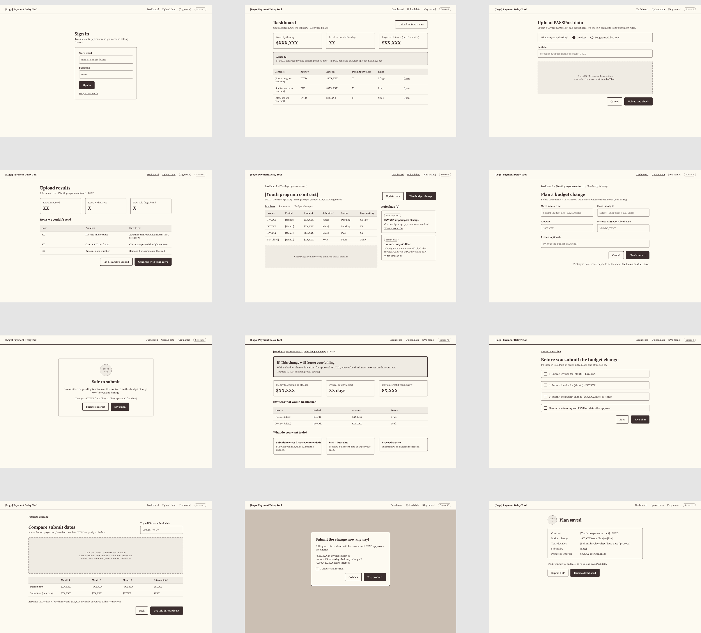

# Requirements

## Functional requirements

**FR1: Data ingestion.** Pull contracts and payments from Checkbook NYC by vendor name or
EIN, and accept uploaded PASSPort CSVs of invoices and budget modifications, reporting any
rows that fail to parse.

> Open question: the community-built Checkbook NYC tools
> ([BetaNYC](https://github.com/BetaNYC/nyc-checkbook-mcp)) filter contracts by vendor
> code only and payments by payee name, and list no EIN search, invoice status or budget
> change status. Confirm against the Checkbook NYC API itself before building FR1.

**FR2: Rule and freeze alerts.** Check invoices and budget changes against agency rules and
flag violations with a citation. Warn before a change triggers a billing freeze (for
example, DYCD's freeze on new invoices while a budget change request is pending, per the
DYCD FY27 Fiscal Manual, p. 43) and estimate the delay.

**FR3: 3-month cash forecast.** Project weekly cash for 90 days from agency payment lags,
payroll and other expenses, and credit-line terms. Show projected interest, compare
scenarios, and export to PDF or CSV.

## Primary persona

**Maria Delgado, 44, Finance Director at Bronx Youth Futures** (fictional 40-person youth
services nonprofit). She manages $4.2M in DYCD and DHS contracts with one part-time
bookkeeper. Strong in Excel, reluctant PASSPort user.

- **Goals:** make payroll without overdrawing the credit line, get paid faster, and give
  the board an accurate cash outlook.
- **Frustrations:** payments arrive 3 to 6 months late, rules like the invoice freeze catch
  her by surprise, she rebuilds spreadsheets by hand every month, and interest eats into
  program money.

> "I just need to know when the money's coming, and stop making mistakes that delay it."

## Journey map

Scenario: October. Summer invoices are unpaid and payroll is in 10 days.
Each stage: action → feeling → pain point → opportunity.

1. **Trigger:** sees payroll will exceed cash → anxious → no advance warning →
   low-cash alert from the forecast.
2. **Investigate:** checks PASSPort, emails DYCD → frustrated → vague statuses, slow
   replies → one dashboard for all invoices and payments.
3. **Upload data:** uploads PASSPort CSVs; Checkbook data loads → hopeful → messy exports →
   clear row-level upload errors.
4. **Review flags:** 3 invoices flagged for a missing document → relieved but annoyed →
   would have found out weeks later → cited rules and fix steps.
5. **Plan budget mod:** gets a 3-week freeze warning → relieved → billing would have
   frozen → suggested submission timing.
6. **Forecast:** compares scenarios and borrows $150K instead of $400K → confident →
   interest used to be invisible → side-by-side interest projections.
7. **Report:** exports the forecast for the board → in control → reports took hours →
   one-click export and payment alerts.

## User flow: check a budget change before submitting it

## Low-fidelity wireframes

## Full user flow and wireframes

The complete flow for checking a budget change, from sign-in to a saved plan, in 12
screens. It adds what the summary above leaves out: the PASSPort CSV upload and its error
results, the contract detail page with rule flags, and the three options after a freeze
warning (submit invoices first, pick a later date, or proceed anyway).

Figma: [user flow](https://www.figma.com/board/FJkeJQ7BzpxJN9oyfm4Grj/User-Flow---Check-Budget-Change-Before-Submitting?node-id=0-1)
· [wireframes](https://www.figma.com/design/sTVCSEuEzhfQ6UcmhGVZOg/Payment-Delay-Tool---Wireframes?node-id=0-1)
(the Figma files are the latest version; the images below are snapshots)

| # | Screen | # | Screen |
|---|---|---|---|
| 1 | Sign in | 7a | Safe to submit |
| 2 | Dashboard | 7b | Billing freeze warning |
| 3 | Upload PASSPort CSV | 8 | Checklist: submit invoices first |
| 4 | Upload results | 9 | Compare submit dates |
| 5 | Contract detail | 10 | Confirm risk |
| 6 | Plan a budget change | 11 | Plan saved |

